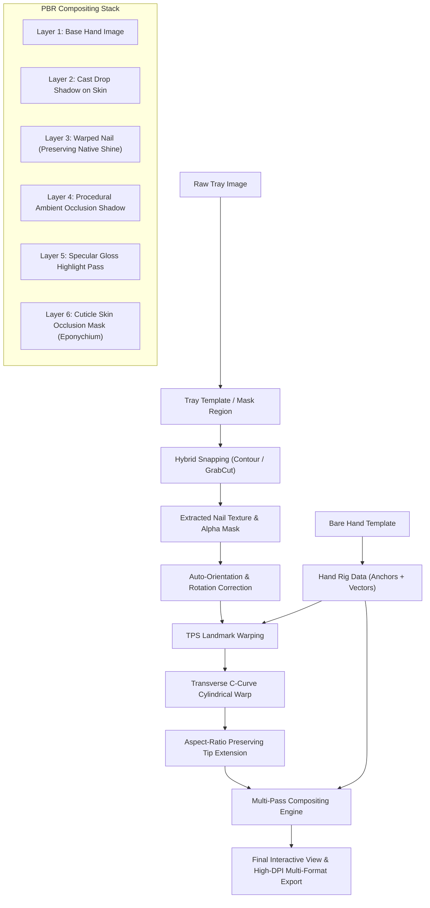

# Press-On Nail Mockup Generator: Architectural Specification & Roadmap

## 1. Executive Overview

A high-performance, local-first desktop application built with **Tauri v2** (Rust + React 19) and a persistent **Python/OpenCV sidecar**. It automates the extraction of press-on nail textures from packaging tray photographs and photorealistically composites them onto a 5-finger bare-hand template using Thin-Plate Spline (TPS) warping, 3D cylindrical C-curve distortion, and multi-pass PBR contact shadows and specular reflections.

```
┌────────────────────────────────────────────────────────────────────────┐
│                        Tauri v2 Desktop App                           │
│  ┌────────────────────────┐         ┌───────────────────────────────┐  │
│  │ React 19 + Canvas UI   │◄───────►│ Rust Core (Windowing/File IO) │  │
│  │ - Tray Slot & Mask Tool│ (IPC)   │ - Sidecar Process Lifecycle   │  │
│  │ - Hand Rigging Wizard  │         │ - Local Filesystem Management │  │
│  │ - Dual-Tier Lighting   │         └───────────────▲───────────────┘  │
│  └───────────▲────────────┘                         │                  │
│              │ (Fast JSON-RPC / WebSocket)          │                  │
│              ▼                                      ▼                  │
│  ┌──────────────────────────────────────────────────────────────────┐  │
│  │                    Persistent Python Sidecar                     │  │
│  │ - OpenCV / NumPy Contour Snapping & GrabCut Refinement           │  │
│  │ - SciPy Rbf / TPS Coordinate Warper + C-Curve Distortion         │  │
│  │ - PBR Compositing Engine (Occlusion, AO Shadows, Specular Gloss)  │  │
│  │ - High-DPI Exporter (PNG, JPG, Transparent, Multi-Layer PSD)     │  │
│  └──────────────────────────────────────────────────────────────────┘  │
└────────────────────────────────────────────────────────────────────────┘
```

---

## 2. Core Architecture & Tech Stack

| Component | Technology | Rationale |
| :--- | :--- | :--- |
| **Shell & App Lifecycle** | **Tauri v2** (Rust) | Native performance, tiny binary footprint, strict local-first security, cross-platform OS dialogs. |
| **Frontend Framework** | **React 19 + Vite + TailwindCSS** | Rapid UI development, rich ecosystem of slider/modal controls, declarative state. |
| **Canvas Manipulation** | **HTML5 Canvas / Fabric.js** | Multi-canvas pan/zoom, interactive anchor pin dragging, rotation handles, brush/eraser mask touch-ups. |
| **Sidecar Process** | **Python 3.10+ (OpenCV, NumPy, SciPy)** | Best-in-class image processing, contour algorithms, RBF/TPS warping, and image I/O. |
| **Sidecar IPC** | **Persistent Local JSON-RPC over Stdio / Localhost Socket** | Sub-second interactive latency, keeps loaded templates and intermediate image buffers warm in memory. |
| **Export Engine** | **Pillow / `pytoshop` / OpenCV** | Generates 300 DPI exports and layered PSDs with isolated blend modes. |

---

## 3. Computer Vision & Graphics Pipeline



### 3.1. Tray Segmentation & Extraction
1. **Tray Layouts & Masks**:
   - Reusable template definitions storing relative bounding boxes for tray grids (e.g., 2×5, 2×12, circular).
   - User can draw custom bounding regions or polygon masks on top of any arbitrary tray photo.
2. **Hybrid Snapping**:
   - Within each designated region, OpenCV applies bilateral filtering, Otsu/adaptive thresholding, and morphological operations to identify the primary nail contour.
   - For low-contrast edges (e.g., clear or light-colored press-on nails on transparent trays), an iterative GrabCut pass refines the foreground boundary.
   - Interactive points are exposed on canvas allowing the user to tweak control vertices, paint/erase edge boundaries, and rotate the extraction angle.
3. **Orientation Normalization**:
   - The contour's longitudinal axis is determined via minimum area bounding box and second-order central moments.
   - Cuticle vs. tip direction is auto-inferred using contour width gradient (cuticle base has broader curvature; free edge tapers or squares). A 180° flip toggle and fine rotation wheel allow quick manual override.

### 3.2. Hand Rigging & Template Authoring Wizard
The application includes an in-app authoring tool to convert any bare-hand photograph into a calibrated template (`.nailtemplate`):
1. **Interactive Landmark Pinning**:
   - For each of the 5 fingers (Thumb, Index, Middle, Ring, Pinky), the user clicks 5 key anchor points:
     - Cuticle Apex (top center of proximal fold)
     - Left Cuticle Corner & Right Cuticle Corner
     - Left Lateral Sidewall & Right Lateral Sidewall
     - Finger Directional Vector (baseline angle of the proximal phalanx)
2. **Procedural Map Generation**:
   - **Cuticle Skin Occlusion Mask**: Extracts the natural skin curve over the nail base; generates an alpha mask so the composite tucks the nail beneath the real cuticle fold.
   - **Ambient Occlusion Contact Shadow Map**: Computes distance-field shadow gradients around the lateral nail grooves and proximal fold.
   - **Specular Gloss Reflection Map**: Computes longitudinal highlights aligned with the finger's directional axis and transverse curvature.
   - Touch-up brush/eraser tools allow fine-tuning procedural maps directly on canvas.

### 3.3. Thin-Plate Spline (TPS) & 3D Curvature Warping
- **Cuticle & Sidewall Anchoring**: Source contour points along the nail base and sides are mapped via 2D Thin-Plate Spline (`scipy.interpolate.RBFInterpolator` with thin-plate basis function \(r^2 \ln r\)) onto the finger's cuticle and sidewall anchors.
- **Aspect-Ratio Preserving Tip Extension**:
  - The nail tip is extended forward along the finger directional vector proportionally to the extracted nail's real aspect ratio.
  - A user-controlled slider allows custom length scaling (Short, Medium, Long, Extra-Long).
- **C-Curve Cylindrical Distortion**:
  - Applies transverse non-linear barrel compression across the nail's width to simulate the 3D curvature wrapping around the cylindrical nail plate.

### 3.4. Dual-Tier PBR Lighting & Compositing
Preserves the nail's authentic photo textures and native shine while introducing realistic environmental lighting:
- **Layer 1: Base Hand**: Original photograph of the hand.
- **Layer 2: Tip Cast Shadow**: Directional soft shadow cast by extended tips onto the fingertip skin or adjacent fingers.
- **Layer 3: Warped Nail Texture**: Warped RGB nail texture with alpha border anti-aliasing.
- **Layer 4: Ambient Occlusion**: Soft-multiply contact shadow at the cuticle junction.
- **Layer 5: Specular Gloss Highlight**: Screen/Add blend pass matching the scene's primary light vector.
- **Layer 6: Cuticle Skin Overlay**: Eponychium skin fold composited over the nail base via the skin occlusion mask.

#### Control Modes:
- **Basic Mode**: Lighting environment presets (Studio Softbox, Ring Light, Direct Flash, Natural Daylight) with master *Gloss Intensity* and *Shadow Depth* sliders.
- **Advanced Mode**:
  - Light Direction (Angle & Elevation)
  - Specular Roughness & Highlight Spread
  - Cuticle Contact Shadow Density
  - Tip Drop-Shadow Distance & Blur Radius
  - Tray Glare Suppression (reduces harsh flash hotspots from packaging plastic)

---

## 4. Production Export Formats

1. **High-Resolution Flattened**: 300 DPI PNG / JPEG in standard e-commerce ratios (1:1 Square, 4:5 Portrait, 16:9 Banner).
2. **Transparent Hand PNG**: Isolated hand and nail composite with transparent background for catalog insertion.
3. **Layered PSD / TIFF**: Multi-layer Photoshop document containing:
   - `[Pass 6]` Cuticle Fold (Normal)
   - `[Pass 5]` Specular Highlights (Screen / Linear Dodge)
   - `[Pass 4]` Ambient Occlusion (Multiply)
   - `[Pass 3]` Warped Press-On Nails (Normal)
   - `[Pass 2]` Nail Drop Shadows (Multiply)
   - `[Pass 1]` Base Hand Template (Normal)

---

---

## 5. Cross-Platform Architecture: macOS & Windows Parity

To ensure seamless native execution, high performance, and zero dependency friction for end users on both macOS and Windows, the architecture implements the following cross-platform specifications:

```
┌────────────────────────────────────────────────────────────────────────┐
│                        Cross-Platform Matrix                           │
├───────────────────────┬────────────────────────────────────────────────┤
│ Feature               │ macOS (Intel & Apple Silicon) │ Windows (10/11 x64)            │
├───────────────────────┼───────────────────────────────┼────────────────────────────────┤
│ Target Triplets       │ aarch64-apple-darwin          │ x86_64-pc-windows-msvc         │
│                       │ x86_64-apple-darwin           │                                │
│ Packaging Formats     │ DMG, .app (Universal / ARM64) │ NSIS (.exe), MSI               │
│ Python Sidecar Naming │ nail-sidecar-<triplet>        │ nail-sidecar-<triplet>.exe     │
│ Process Lifecycle     │ POSIX SIGTERM / SIGHUP        │ Windows Job Object (Auto-Kill) │
│ User Templates Path   │ ~/Library/Application Support/│ %APPDATA%\com.presson.mockup\  │
│ Code Signing          │ Apple Developer ID + Notarize │ Authenticode Code Signing      │
└───────────────────────┴───────────────────────────────┴────────────────────────────────┘
```

### 5.1. Tauri v2 Target Matrix & Sidecar Packaging
- **Tauri External Binary Convention**:
  Tauri v2 requires sidecar binaries to be placed in `src-tauri/binaries/` with the exact target triplet suffix:
  - macOS Apple Silicon (M1/M2/M3/M4): `src-tauri/binaries/nail-sidecar-aarch64-apple-darwin`
  - macOS Intel: `src-tauri/binaries/nail-sidecar-x86_64-apple-darwin`
  - Windows x64: `src-tauri/binaries/nail-sidecar-x86_64-pc-windows-msvc.exe`
- **Headless Sidecar Build**:
  - Built with PyInstaller using `--noconsole` and `opencv-python-headless` (strictly avoiding GUI backend dependencies like Qt/Cocoa/GTK that conflict with native host windowing).
  - Bundled C++ runtime dependencies (Visual C++ Redistributable static linking or bundling `vcruntime140.dll` on Windows; universal binary lipo or dual-arch builds on macOS).

### 5.2. Robust Process Lifecycle & Zombie Prevention
- **Windows Job Objects**: On Windows, child processes normally remain running as orphans if the host crashes. The Tauri Rust backend wraps the spawned sidecar process in a Win32 **Job Object** configured with `JOB_OBJECT_LIMIT_KILL_ON_JOB_CLOSE`. When the Tauri process terminates, the OS automatically kills `nail-sidecar.exe`.
- **macOS Signal Handling**: On macOS, Rust handles `SIGINT` / `SIGTERM` / `SIGHUP` and terminates child process groups via POSIX process groups (`libc::kill(-pgid, SIGTERM)`).

### 5.3. Firewall-Free IPC Protocol
- Communication uses **stdio line-delimited JSON-RPC** over stdin/stdout rather than local TCP network ports.
- **Rationale**: Local TCP sockets often trigger intrusive Windows Defender Firewall alerts or macOS network permission dialogs upon first launch. Stdio pipes are fast, permissionless, and completely private to the parent-child process tree.

### 5.4. Filesystem & Path Normalization
- Hand templates, tray presets, and user configurations are stored in OS-standard app data directories resolved via Tauri's path API:
  - macOS: `~/Library/Application Support/com.presson.mockup-generator/`
  - Windows: `%APPDATA%\com.presson.mockup-generator\`
- All path serializations over JSON-RPC use normalized UTF-8 paths handled via Rust `std::path::PathBuf` and Python `pathlib.Path`, avoiding path separator (`/` vs `\`) mismatch issues.

---

## 6. Implementation Roadmap

### Phase 1: Core Engine, Cross-Platform Sidecar & IPC Setup
- [ ] Initialize Tauri v2 project structure (`src-tauri` Rust harness, `src` React 19 frontend).
- [ ] Configure cross-platform Python sidecar build script (PyInstaller for macOS universal/x86/ARM64 and Windows x64).
- [ ] Implement Rust sidecar manager with Windows Job Object auto-kill and macOS signal handling over stdio JSON-RPC.
- [ ] Implement OpenCV contour detection, GrabCut segmentation, and moment-based orientation.
- [ ] Implement TPS warping with SciPy RBF and cylindrical transverse curvature distortion.

### Phase 2: Hand Template Authoring Wizard
- [ ] Build 5-point landmark placement canvas tool in React with cross-platform DPI scaling.
- [ ] Implement procedural generator for cuticle occlusion, AO contact shadow, and specular gloss maps.
- [ ] Implement `.nailtemplate` bundle serializer (metadata JSON + PNG maps) with OS-standard AppData storage.

### Phase 3: Tray Extraction & Interactive Mapping
- [ ] Build tray layout template manager (grid presets + custom region drawing).
- [ ] Create interactive contour refinement UI (vertex editor, rotation wheel, brush/eraser).
- [ ] Create visual drag-and-drop finger chip assignment (Thumb, Index, Middle, Ring, Pinky).

### Phase 4: Compositing, Lighting UI & Export
- [ ] Implement multi-layer compositing engine in Python sidecar with live preview cache.
- [ ] Build dual-tier lighting controls (Basic Presets + Advanced Sliders).
- [ ] Implement high-resolution export pipeline (PNG, transparent hand, layered PSD via `pytoshop`).
- [ ] Configure GitHub Actions CI workflow to build and package DMG/app for macOS and NSIS/MSI for Windows.

