# Hand & Nail Fitting: Architectural Options, Possibilities & Open Questions

> **Executive Context:** This document examines the engineering challenge of naturally fitting digital press-on nail textures onto human hand photographs without relying on heuristic guesses. It analyzes 5 architectural approaches across the computer vision and 3D graphics spectrum, presents a technical trade-off matrix, and details all open questions and operational doubts for Try-On Studio.

---

## 1. The Anatomy of Natural Fitting: Why Geometric Guessing Fails

Currently, [`python_sidecar/template_generator.py`](file:///c:/Users/Timuas/Projects/try-on-studio/python_sidecar/template_generator.py#L484-L650) estimates fingertips using 1D color peaks and guesses nail-bed anchors ($c_l, c_c, c_r, d_l, d_r$) using fixed geometric fractions of finger width ($2.2 \times W_{\text{half}}$). 

In human perception, fingernails are recognized as fake when four physical rules are violated:

```
                          ┌───────────────────────────┐
                          │   Cuticle Pocket Fold     │
                          │ (Eponychium tuck + shadow)│
                          └─────────────┬─────────────┘
                                        │
┌───────────────────────────┐           │           ┌───────────────────────────┐
│     Lateral Sidewall      │◄──────────┼──────────►│     Lateral Sidewall      │
│  (Paronychium skin-seam)  │           │           │  (Paronychium skin-seam)  │
└───────────────────────────┘           │           └───────────────────────────┘
                                        ▼
                          ┌───────────────────────────┐
                          │    3D Barrel Curvature    │
                          │   (C-Curve compression)   │
                          └───────────────────────────┘
```

1. **The Cuticle Pocket (Eponychium Tuck):**
   * Real nails grow from under the proximal nail fold (eponychium).
   * A digital nail placed *over* the cuticle looks like a floating decal. Realism requires tucking the proximal boundary *under* the skin and casting a micro ambient occlusion shadow.
2. **The 3D Cylindrical Barrel Distortion (The "C-Curve"):**
   * Fingernails have transverse arch curvature (a cylindrical section). The center faces the camera flat, while the sidewalls curve away, compressing the texture near the boundaries.
3. **Lateral Nail Fold Anchoring (The Sidewall Seam):**
   * If the placed nail is 1–2 mm too wide, it overlaps the fleshy finger skin. If 1–2 mm too narrow, the natural nail peeks through.
4. **Distal Bone Alignment (Hand Posture & Angled Thumbs):**
   * Fingers rarely point perfectly upright. The thumb is naturally abducted and rotated at an oblique angle. Classical peak detection treats all fingers as parallel vertical rays, resulting in sheared or misaligned thumb placements.

---

## 2. Technical Possibilities & Architectural Options

```mermaid
flowchart TD
    subgraph Option 1: Two-Stage 2D/2.5D Neural Perception
        O1A["Full Hand Photo"] --> O1B["MediaPipe Hands (21 3D Joint Skeleton)"]
        O1B --> O1C["Upright Fingertip Crops Along Bone Vectors"]
        O1C --> O1D["Nail-Bed Segmentation / Keypoint Model"]
        O1D --> O1E["3-Tier TPS Warp + 2.5D C-Curve + Cuticle Pocket Tuck"]
    end

    subgraph Option 2: 3D Hand Mesh Estimation
        O2A["Full Hand Photo"] --> O2B["HaMeR / MANO 3D Hand Regressor"]
        O2B --> O2C["Articulated 3D Hand Polygon Mesh"]
        O2C --> O2D["Attach 3D Parametric Curved Nail Mesh to Phalanx Bone"]
        O2D --> O2E["Standard 3D PBR GPU Rendering & Shadow Casting"]
    end

    subgraph Option 3: Computer-Assisted Smart Snapping
        O3A["Hand Template"] --> O3B["Edge-Gradient / Skeleton Anchor Proposals"]
        O3B --> O3C["Interactive Magnetic Bezier Handles in UI"]
        O3C --> O3D["Magnetic Locking to High-Contrast Nail-Bed Seams"]
    end
```



---

### Option 1: Two-Stage 2D/2.5D Neural Perception (MediaPipe + Nail-Bed Model)
* **How it Works:**
  1. **MediaPipe Hands:** Runs on the hand photo in ~15 ms on CPU. Extracts the 21 3D skeletal joints and handedness (`Left` vs `Right`). Computes the exact 3D bone orientation vector $\vec{v} = P_{\text{TIP}} - P_{\text{DIP}}$ for every finger, including sideways thumbs.
  2. **Upright Crop:** Rotates and crops each fingertip into a normalized, upright $256 \times 256$ window.
  3. **Nail-Bed Segmentation / Keypoint Model:** A lightweight model (e.g. YOLO11n-pose or pre-trained fingernail segmenter) extracts the exact cuticle curve $[c_l, c_c, c_r]$ and lateral sidewalls $[d_l, d_r]$.
  4. **2.5D Shader:** Uses the existing 3-tier TPS warp in `warping.py`, applying C-curve cylindrical barrel distortion and tucking the top boundary beneath the segmented cuticle pocket.
* **Advantages:**
  * **Zero texture degradation:** Preserves 100% of the tray photo's photographic detail (glitter, micro-crystals, chrome gradients).
  * **Ultra-lightweight:** Models add $< 25\text{ MB}$ to the application bundle.
  * **Fast:** Total end-to-end processing $< 60\text{ ms}$ on CPU.
* **Limitations:**
  * Uses simulated 2.5D depth. If a finger is photographed at an extreme perspective angle ($> 45^\circ$ pointed directly toward the lens), subtle foreshortening differences can occur.

---

### Option 2: Full 3D Parametric Hand Mesh (HaMeR / MANO / InstantHMR)
* **How it Works:**
  1. A deep neural network (such as **HaMeR** from UC Berkeley or **MANO**) regresses a full 3D polygon mesh of the hand directly from the 2D photograph.
  2. A 3D parametric curved shell of the press-on nail is parented directly to the 3D distal phalanx bone.
  3. The extracted 2D tray texture is projected as a UV material onto the 3D nail shell and rendered using a real 3D shader with physical shadows and ambient occlusion.
* **Advantages:**
  * **True 3D Physics:** Surface normals, camera perspective, lighting, and occlusions are mathematically genuine 3D.
  * Natural barrel C-curve is physically built into the 3D polygon shell.
* **Limitations:**
  * **Heavy Application Footprint:** Model weights are $500\text{ MB} - 1.5\text{ GB}$, requiring PyTorch and heavy GPU compute.
  * **Latency:** Takes $500\text{ ms} - 1.5\text{ s}$ per hand.
  * **The "Generic Fingertip" Problem:** Standard 3D hand models (like MANO) use a generic average finger shape. They often do not match the specific cuticle wrinkles, unique fingernail shapes, or individual proportions of a real photograph without complex dense surface fitting.

---

### Option 3: Computer-Assisted "Smart Snapping" (Human-in-the-Loop)
* **How it Works:**
  1. The system proposes initial anchor locations using classical edge gradients or MediaPipe skeleton joints.
  2. The UI displays 5 interactive control handles per finger.
  3. Control points feature **magnetic edge snapping**: dragging an anchor near the cuticle or sidewall causes it to magnetically lock onto the highest-contrast skin-nail boundary.
* **Advantages:**
  * **Zero Failure Rate:** If an AI model fails on dark skin or unusual lighting, the user can adjust it in 5 seconds.
  * **Zero Dependencies:** Requires no neural model weights or extra dependencies.
* **Limitations:**
  * Requires 10–20 seconds of user interaction per hand template, rather than being a 1-click automatic import.

---

### Option 4: Generative AI Inpainting / Diffusion Seam Blending (ControlNet / FLUX)
* **How it Works:**
  1. The nail is placed coarsely over the finger.
  2. A localized inpainting diffusion model blends the cuticle fold and renders photorealistic contact shadows.
* **Advantages:**
  * Produces smooth, natural skin-to-nail seam transitions.
* **Limitations:**
  * **Art Distortion:** Diffusion models are non-deterministic and frequently hallucinate, alter fine line art, blur rhinestones, or shift colors.
  * **Heavy & Slow:** Requires 6–12 GB VRAM and takes 3–10 seconds per image.
  * Unsuitable for a local-first, lightweight desktop application.

---

### Option 5: Hybrid Master-Template System (Curated Hand Models + Free Photo Upload)
* **How it Works:**
  1. **Bundled Salon Master Templates:** Try-On Studio ships with 5–8 professionally shot, pre-rigged master hand templates (diverse skin tones, nail bed shapes, and salon lighting). On these templates, the fit is 100% pre-calculated and mathematically flawless.
  2. **Custom User Uploads:** When a user uploads their own custom hand photo, the app runs Option 1 (MediaPipe + Nail-Bed Model) with Option 3 (interactive nudge handles) as a fallback.
* **Advantages:**
  * Provides instant commercial catalog creation for 90% of use cases with zero setup time, while still offering the flexibility of custom photo uploads.

---

## 3. Comparison & Trade-off Matrix

| Criteria | Option 1: Two-Stage (MediaPipe + Seg) | Option 2: 3D Hand Mesh (HaMeR/MANO) | Option 3: Smart Snapping | Option 4: Generative Inpainting | Option 5: Hybrid Master + Custom |
| :--- | :--- | :--- | :--- | :--- | :--- |
| **Visual Naturalness** | **92–96%** | **90–95%** | **98% (User tuned)** | **94% (Risk of artifacts)** | **99% (Master) / 95% (Custom)** |
| **Nail Art Preservation** | ✅ **100% byte-exact** | ✅ **100% byte-exact** | ✅ **100% byte-exact** | ❌ Modifies fine art | ✅ **100% byte-exact** |
| **Inference Latency** | **< 60 ms (Instant)** | ~800–1500 ms | Instant | 3–10 seconds | **< 5 ms (Master) / < 60 ms** |
| **Desktop Download Size**| **~20 MB** | **~800 MB–1.2 GB** | **0 MB** | **~4–8 GB** | **~25 MB** |
| **Hardware Required** | Low CPU / Any GPU | Dedicated GPU | Any machine | High-End GPU (8GB+) | Any machine |
| **User Effort** | 1-Click | 1-Click | 15s fine-tuning | 1-Click | **0s (Master) / 1-Click (Custom)**|

---

## 4. Key Doubts, Questions & Strategic Decisions

To determine the optimal engineering path for Try-On Studio, consider the following open questions:

### Question 1: Product Positioning & Target Audience
* **Are users primarily Press-On Nail Sellers / E-Commerce Brands?**
  * *If YES:* Sellers prioritize **flawless presentation, commercial catalog consistency, and speed**. They almost always prefer working with 5–6 consistent, beautiful master hand models (Light, Medium, Deep, Warm, Cool tones) where lighting and angles are studio-grade.
* **Or are users primarily End-Consumers doing a virtual mirror try-on of their own hands?**
  * *If YES:* The system must prioritize handling arbitrary smartphone camera selfies (messy bedroom lighting, tilted hands, backgrounds).

### Question 2: The "Natural Nail Length Mismatch" Problem
* What happens when the user's natural nail in the photo is **longer** than the press-on nail being tried on, or has chipped polish?
  * *Possibility A:* The press-on nail covers the natural nail, but if the natural nail extends laterally past the press-on sidewall, the natural nail peeks out.
  * *Possibility B:* Should the system automatically inpaint/erase the natural free-edge of the finger before placing the new press-on nail?

### Question 3: Sheer / Transparent Jelly Press-On Nails
* If a press-on nail has a **sheer/translucent nude base** or clear French sections:
  * In real life, the natural nail bed and lunula (the white half-moon at the cuticle) show through the plastic.
  * In a composite, if the underlying natural nail has bright red polish or defects, that will bleed through a sheer press-on.
  * *Question:* Should Try-On Studio assume all press-ons are opaque, or should it support translucent blending with a clean synthetic nail bed?

### Question 4: Degree of Automation vs. User Control
* Many professional design tools (Photoshop, Canva, Figma) provide **AI auto-placement + micro-nudge handles**.
* If an AI placement is 95% accurate, but a user wants to move the cuticle anchor 2 pixels to the left for a catalog print, do you want interactive control handles on the rigging canvas, or should the app remain strictly zero-touch?

### Question 5: Desktop Distribution Constraints
* Tauri v2 apps are known for their compact footprint (typically < 80 MB installers).
* Incorporating Option 1 (MediaPipe + YOLO ONNX) maintains a lean **~100 MB total installer**.
* Moving to full 3D hand mesh reconstruction (Option 2) or Diffusion (Option 4) will expand the installer to **1.5 GB – 6 GB** and require dedicated GPU hardware. Is keeping a lean, lightweight desktop app a core priority?
