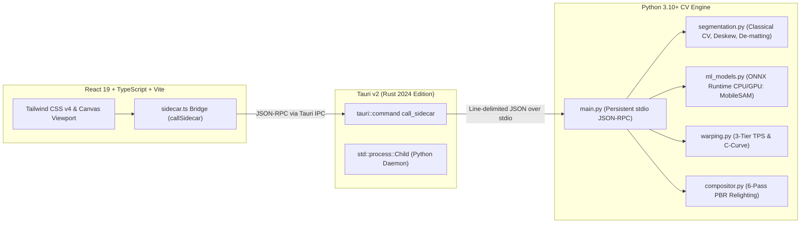
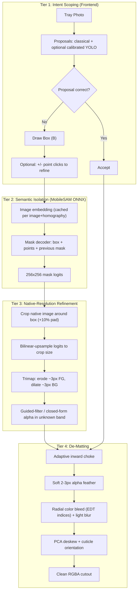

# Technical Specification & Implementation Plan (v2): Smart Hybrid Nail Extraction & De-Matting Engine

> **Revision notes (v2).** This revision keeps the original diagnosis and architecture and changes the following:
> - Specifies the native-resolution refinement step (logits -> trimap -> matting), which was previously only "gradient snapping".
> - Makes the choke adaptive and designs it together with the specular clamp.
> - Removes the silent ML fallback and adds observability.
> - Adds positive/negative point prompts to the box tool.
> - Fixes per-side inpainting gating.
> - Defines one coordinate convention and one pipeline order.
> - Replaces "inspect the image" gates with measurable acceptance criteria.
> - Corrects MobileSAM attribution and licensing notes.

---

## 1. Executive Summary & Application Overview

### 1.1 What is Try-On Studio?
**Try-On Studio** is a local-first, privacy-focused desktop application for e-commerce brands, nail technicians, and press-on nail designers. It **extracts real press-on nail textures from product tray photos** (packaging cards, blister packs, flat-lays) and **composites them photorealistically onto a 5-finger bare-hand template photo** using physical relighting, anatomical cuticle tucking, and thin-plate spline warping.

#### Primary User Workflow
1. **Tray Extractor**: Import a flat packaging tray photo, then extract each press-on nail (Thumb, Index, Middle, Ring, Pinky) with pixel-clean boundaries.
2. **Hand Rigging**: Align 5 anatomical landmarks per finger (`c_l`, `c_c`, `c_r` at the proximal cuticle fold; `d_l`, `d_r` at the distal lateral grooves) on a bare-hand photo.
3. **PBR Composite & Live Viewport**: Apply 3D cylindrical C-curve warping, longitudinal apex curvature, studio diffuse relighting, clear-gel topcoat specular sheen, and contact crease shadows in real time.
4. **Production Export**: Export 300 DPI e-commerce PNGs with physical metadata, or layered PSD files with non-destructive layer masks.

### 1.2 Goals of This Revision
| # | Goal | Measurable outcome |
|---|------|--------------------|
| G1 | Eliminate the white "milky" halo | Halo luminance delta <= 2 L* on light, medium and dark skin tones |
| G2 | Make extraction work on hard trays (white French tips, jelly nails, charms, gold text) | Mask IoU >= 0.95 on the benchmark set, with at most 2 user prompts per nail |
| G3 | Remove fingertip smudge artifacts | Zero inpainting on fully covered natural nails; texture-preserving fill otherwise |
| G4 | Make failures visible, never silent | Every extraction reports which method ran; tests assert it |
| G5 | Make quality verifiable | Automated metric gates replace visual inspection |

---

## 2. Current Technical Architecture & Modules

Dual-process, local-first topology:



### Current Extraction Stack
1. **Classical CV (`segmentation.py`)**
   * **Perspective rectification:** `find_packaging_card_quad` detects the card corners; homography $H$ warps to a fronto-parallel plane.
   * **Thresholding:** Otsu + CIE LAB $A^*$ deviation + HSV saturation separate nail foreground from cardboard.
   * **Contour smoothing & orientation:** PCA (`deskew_nail_pca`), aspect-ratio heuristics for cuticle-down orientation, Savitzky-Golay smoothed bilateral profiles.
2. **Fine-tuned YOLO11n-seg (`ml_models.py`)**
   * Trained on 7 trays (105 instances), exported to `models/yolo11n_tray_1024.onnx`. Currently ineffective (see Issue 2).

---

## 3. Current Issues & Root-Cause Audit

### Issue 1: White Fringing / "Milky Outer Glow"
* **Symptom:** A hazy white outline ("sticker glow") surrounds every composited nail.
* **Root cause:** Press-on nails sit on white or light-gray cards, and their curved lateral bevels mirror the card. The edge pixels' *color* is contaminated by the card, so alpha feathering blends white over the skin.
* **Evidence (`nail_2_index.png`):**
  * Interior solid nail mean BGR: `[80.8, 70.1, 111.4]` (mauve/burgundy).
  * Edge pixels (alpha 1-240) mean BGR: `[118.7, 113.6, 140.9]`, maximum `[241, 242, 249]` (card white).
  * The PBR specular and skin-wrap passes amplify brightness within the outer ~2 px.

### Issue 2: Custom Model Ineffective and Silently Skipped
* **Symptom:** YOLO fine-tuning produced no visible improvement.
* **Root causes:**
  1. `conf_thresh = 0.35` hardcoded, but the model's scores peaked at 0.12-0.165 (7-image training set), so it returned 0 detections.
  2. The guard `if ml_slots and len(ml_slots) >= 5:` silently fell back to classical CV 100% of the time. **This silent fallback is the real bug.**
  3. YOLO-seg needs 100+ varied images for robust margins, and its 256x256 prototype masks yield coarse polygon edges on 3000 px photos.

### Issue 3: Fingertip Inpainting Smudge
* **Symptom:** A faint rectangular discolored patch around the fingertip (visible on the index finger).
* **Root cause:** `erase_exposed_natural_nails` inpaints an expanded polygon with `cv2.inpaint` even when no natural nail is exposed, replacing real skin pores with a blur.

### Issue 4: No Efficient Fallback When Auto-Detection Fails
* **Symptom:** White French tips on white cards, clear jelly nails, and trays with dense gold text defeat classical segmentation.
* **Root cause:** The only manual alternative is Bezier pen drawing (15-20 clicks per nail).

---

## 4. The Proposed Solution: The Smart Hybrid Pipeline

Combines **user intent** (a loose box), **MobileSAM** (zero-shot promptable segmentation), a **native-resolution refinement** stage, and **classical color de-matting**.



### 4.1 Canonical Pipeline Order (normative)
1. Obtain a mask (classical proposal **or** SAM).
2. Refine at native resolution (crop, upsample, trimap, matting).
3. Adaptive choke and alpha feather.
4. Radial color de-matting.
5. **Then** PCA deskew and cuticle orientation.
6. Emit the RGBA cutout and metadata.

Deskew and orientation run **after** de-matting so rotation resampling never reintroduces card-contaminated edge colors.

### 4.2 Canonical Coordinate Convention (normative)
* The frontend sends **original-image pixel coordinates** only, as `[x0, y0, x1, y1]` (corner format). `[x, y, w, h]` is never used on the wire.
* The sidecar alone owns the homography. Rectified-plane coordinates are internal and never cross the IPC boundary.
* Contours returned to the frontend are in original-image pixels.
* A unit test round-trips box -> rectified -> original and asserts error < 0.5 px.

---

## 5. Detailed Engineering Pillars

### Pillar 1: De-Matting (Eliminating the White Glow)

The halo is a **color contamination** problem, so the fix has to repair color, not only alpha.

#### 1a. Adaptive Inward Choke
$$r_{\text{choke}} = \text{clip}\big(\text{round}(0.012 \cdot w_{\text{nail}}),\ 1,\ 3\big)\ \text{px (native resolution)}$$
$$\alpha_{\text{choked}} = \text{erode}(\alpha_{\text{matte}},\ \mathcal{K}_{\text{ellipse}}(r_{\text{choke}}))$$

* The floor (1 px) and cap (3 px) prevent small pinky nails from visibly shrinking.
* **Area guard:** if the choke removes more than 4% of mask area, reduce $r_{\text{choke}}$ by 1 and recompute.
* The choke is not the only defense, because color bleed (1c) fixes the contaminated color. The choke only needs to remove the worst of the bevel reflection.

#### 1b. Soft Alpha Feather
After the choke, apply a 2-3 px Gaussian feather to alpha. A hard edge would give the specular clamp (1d) nothing to act on and would look cut out. **The choke, feather and specular clamp are specified together and tested together.**

#### 1c. Radial Color Bleed (Foreground Color Estimation)
* Solid core: $\mathcal{S} = \{p \mid \alpha(p) \ge 220\}$. Boundary band: $\mathcal{B} = \{p \mid 0 < \alpha(p) < 220\}$.
* Implementation detail (required):
  ```python
  # indices of the nearest core pixel for every pixel
  dist, (iy, ix) = scipy.ndimage.distance_transform_edt(~core_mask, return_indices=True)
  bled = rgb[iy, ix]                      # nearest-core color everywhere
  band = (alpha > 0) & ~core_mask
  bled_blur = cv2.GaussianBlur(bled, (0, 0), sigmaX=1.0)   # 1-2 px; avoids flat edges on glitter/chrome
  rgb_out = np.where(band[..., None], bled_blur, rgb)
  ```
* For each $p \in \mathcal{B}$, $RGB(p) \leftarrow RGB(\arg\min_{q \in \mathcal{S}} \|p - q\|_2)$ (blurred lightly). At $\alpha = 0.15$ the color is nail albedo (`[80, 70, 111]`), never card white.
* Edge case: for white or pale nails (white French tips), the core color is legitimately light. The acceptance test therefore compares edge color to **interior** color, not to a fixed darkness.

#### 1d. Specular Perimeter Clamp (`compositor.py`)
$$\mathcal{M}_{\text{spec}} = \text{clamp}\!\left(\frac{\alpha_{\text{tucked}} - 0.25}{0.35},\ 0,\ 1\right)$$
Multiply the specular ribbon and dome sheen by $\mathcal{M}_{\text{spec}}$. This works only because of the soft feather in 1b. A regression test asserts that no synthetic highlight is deposited within 2 px of the silhouette.

---

### Pillar 2: MobileSAM Promptable Segmentation (~39 MB ONNX)

#### Attribution & Licensing
* MobileSAM is a **distilled, lightweight version of Meta's Segment Anything Model (SAM)**, released by researchers at Kyung Hee University. It is not a Meta product.
* It is released under Apache 2.0. Before distribution, confirm the license of the exact weights and ONNX export used, include the required notices, and record them in `THIRD_PARTY_LICENSES`.

#### Why MobileSAM
* Pretrained at foundation scale; **zero tray-specific training data required**.
* Encoder/decoder split fits an interactive tool: heavy work once, cheap work per prompt.

#### Interface Contract (verify against the exact export)
* **Encoder (`mobile_sam_encoder.onnx`, ~35 MB):** input is the image resized so the longest side is 1024, normalized with mean `[123.675, 116.28, 103.53]` and std `[58.395, 57.12, 57.375]`, padded to 1024x1024. Output is `image_embeddings` of shape `1x256x64x64`.
* **Decoder (`mobile_sam_decoder.onnx`, ~4 MB):** inputs `image_embeddings`, `point_coords`, `point_labels`, `mask_input` (previous 256x256 logits), `has_mask_input`, `orig_im_size`. Output is `masks` and `low_res_masks` (256x256 logits).
* **Prompt encoding:** positive point = label `1`, negative point = label `0`. A box is encoded as two points with labels `2` (top-left) and `3` (bottom-right). Coordinates must be scaled by the same factor as the resized image.
* The preprocessing recipe is covered by a golden test: a fixed image + box must reproduce a stored reference mask (IoU >= 0.99) so export drift is detected.

#### Performance Budgets (targets to be measured, not assumed)
| Stage | Target | Notes |
|-------|--------|-------|
| Encoder, once per tray | <= 1.5 s p95 on baseline laptop CPU | Expected to be a few hundred ms on good hardware; run async with a progress indicator |
| Decoder, per prompt | <= 25 ms p95 | Measured **separately** from the encoder |
| Native refinement (crop, trimap, matting) | <= 150 ms per nail | Crop-local, so independent of full image size |
| End-to-end box -> contour on screen | <= 300 ms | |

#### Embedding Cache
* Key: `sha256(image bytes) + homography hash`. Evict on new tray load and cap at N entries (default 2) to bound memory on large trays.
* Invalidate when the user re-runs rectification or alters card corners.

#### Hard Cases
* **White French tips on white cards:** shape and specular cues separate the smile line; refinement matting handles the low-contrast edge.
* **3D jewels, rhinestones, charms:** treated as part of one instance; a positive point on the charm resolves ambiguity.
* **Clear / jelly nails:** the glossy ridge defines the silhouette. If the mask under-covers, one positive point on the nail body fixes it.

---

### Pillar 3: Native-Resolution Refinement (new; replaces "gradient snapping")

SAM's 256x256 logits are too coarse for 3000 px photos. Refinement is crop-local:

1. **Crop** the native image to the prompt box + 10% padding.
2. **Upsample** the logits bilinearly to the crop size, then threshold at 0 for the binary mask.
3. **Trimap:** erode the mask ~3 px (sure foreground), dilate ~3 px (sure background); everything between is "unknown". Scale the band with nail width (about 1.5% of width, min 2 px).
4. **Solve alpha in the unknown band** using a guided filter (default, fast) with the crop as guide. Closed-form matting or GrabCut is the fallback for low-contrast edges (white tips). Keep the method configurable.
5. **Output:** refined alpha, then Pillar 1 (choke, feather, color bleed).

Quality gate: the boundary of the refined alpha must sit within 1 px of the hand-labeled boundary on at least 95% of benchmark contour points.

---

### Pillar 4: Interactive Box + Point Tool ("Box-to-Nail")

Files: `src/components/canvas/CanvasViewport.tsx`, `src/components/inspector/TrayControls.tsx`.

```mermaid
sequenceDiagram
    autonumber
    actor User
    participant Canvas as CanvasViewport (React 19)
    participant IPC as sidecar.ts Bridge
    participant Rust as Tauri v2 Backend
    participant Py as Python Sidecar (MobileSAM)

    User->>Canvas: Press B (Draw Box)
    User->>Canvas: Drag loose box over nail
    Canvas->>IPC: callSidecar("segment_prompt", { image_id, bbox: [x0,y0,x1,y1], points: [] })
    IPC->>Rust: invoke("call_sidecar")
    Rust->>Py: JSON-RPC over stdio
    Py->>Py: Decoder (~12ms) + native refinement + de-matting
    Py-->>Canvas: { slot_id, contour, bbox, method: "sam", metrics }
    Canvas->>User: Snapped polygon + method badge
    User->>Canvas: Shift-click (add) / Alt-click (remove) to refine
    Canvas->>IPC: callSidecar("segment_prompt", { ..., points: [{x,y,label}], prev_mask_id })
    Py-->>Canvas: Updated contour (decoder re-run only; embedding cached)
```

#### UX Requirements
1. **1-second interaction:** a loose box is enough.
2. **Refinement by points:** Shift-click = positive point, Alt-click = negative point. The previous mask logits are fed back as `mask_input`. This is cheap (decoder only) and recovers most failure cases without Bezier editing.
3. **Slot assignment:** auto-advance Thumb -> Index -> Middle -> Ring -> Pinky, with `1`-`5` to reassign.
4. **Undo/redo:** every prompt is a history entry; `Ctrl/Cmd+Z` steps back through prompts.
5. **Method badge:** each slot displays `SAM`, `Classical` or `Manual`, so the source of every contour is visible.
6. **Bezier handles** remain as the last-resort editor on the final contour.
7. **Accessibility:** all tools are reachable by keyboard, and the box overlay has sufficient contrast on both light and dark cards.

---

### Pillar 5: Surgical, Texture-Preserving Natural-Nail Inpainting

1. **Per-side exposure gating** (replaces total-width gating):
   * In the finger-aligned frame, compute the exposed natural-nail margin on the **left** and **right** separately:
     $m_L = x_{\text{press-on, left}} - x_{\text{natural, left}}$ and likewise $m_R$.
   * Inpaint a side only if its margin exceeds **2 px**. A narrow or off-center/rotated press-on over a square natural nail can expose one side only; per-side gating handles that, and total width does not.
   * If neither side is exposed, **skip inpainting entirely**.
2. **Triangular corner masks:** restrict inpainting to the right-angle regions at $(d_l, c_l)$ and/or $(d_r, c_r)$. For curved natural nail edges, derive the mask from the actual exposed region (natural nail polygon minus press-on silhouette) clipped to these corners. Central cuticle skin and distal fingertip pulp are always excluded.
3. **Texture-preserving fill:** rather than a plain `cv2.inpaint` blur, fill with a patch sampled from adjacent skin (PatchMatch-style or nearest-neighbor texture copy), then feather-blend. If only `cv2.inpaint` is available, re-inject grain by matching local noise statistics so pores do not vanish.
4. **Regression check:** pixels outside the inpaint mask must be bit-identical to the source skin.

---

## 6. API Contract (JSON-RPC, sidecar)

```jsonc
// Request
{ "method": "segment_prompt",
  "params": {
    "image_id": "sha256:...",
    "bbox": [x0, y0, x1, y1],                     // original-image px, corner format
    "points": [{ "x": 0, "y": 0, "label": 1 }],   // 1 = add, 0 = remove (optional)
    "prev_mask_id": "optional",
    "finger_key": "thumb|index|middle|ring|pinky"
  } }

// Response
{ "slot_id": "...",
  "method": "sam" | "classical" | "manual",       // always present
  "contour": [[x, y], ...],                       // original-image px
  "bbox": [x0, y0, x1, y1],
  "shape_info": { ... },
  "metrics": { "decoder_ms": 0, "refine_ms": 0, "choke_px": 2, "area_removed_pct": 1.3 },
  "warnings": [] }
```
Errors are structured (`code`, `message`, `hint`) and shown to the user; none are swallowed.

---

## 7. Observability & Failure Handling (fixes the silent fallback)

* Every extraction returns and logs `method`. The UI shows it.
* **No silent fallbacks.** If MobileSAM is unavailable (missing model, ONNX error), the sidecar returns an explicit warning, and the UI shows "ML unavailable, using classical". The old `len(ml_slots) >= 5` pattern is removed.
* If an optional YOLO proposer is kept, its confidence threshold is **calibrated from the measured score distribution** on validation data (not hardcoded), and the chosen threshold is logged.
* Tests assert which path ran for each benchmark case (e.g., white-French-tip trays must report `sam` or `manual`, never `classical`).
* A diagnostics panel lists model versions, execution provider (CPU/GPU), and per-stage timings.

---

## 8. Verification & Acceptance Criteria (replaces visual inspection)

All thresholds are initial targets to be confirmed on the benchmark data.

| Metric | Method | Gate |
|--------|--------|------|
| Mask quality | IoU vs hand-labeled masks on the 9 benchmark sets | >= 0.95 mean, no nail < 0.90 |
| Edge color purity | Mean $\Delta E_{2000}$ between feather-band color and interior color | <= 5 (<= 3 target) |
| Halo test | Composite onto 3 skin tones (light, medium, dark); mean L* of a 2 px ring outside the silhouette minus local skin baseline | <= 2 L* |
| Specular clamp | Max synthetic highlight within 2 px of silhouette | 0 |
| Choke safety | Area removed by choke | <= 4% per nail |
| Inpaint safety | Pixels outside inpaint mask vs source | Identical; masks empty when no exposure |
| Coordinate round-trip | Box -> rectified -> original | < 0.5 px error |
| Golden SAM test | Fixed image + box vs stored mask | IoU >= 0.99 |
| Latency | Decoder p95 / end-to-end box-to-screen | <= 25 ms / <= 300 ms |
| Prompt efficiency | Prompts needed per nail on hard cases | <= 2 |

Visual inspection (`test_output/03_studio_relit_hand.jpg`) is kept as a **supplement** to these metrics, not a substitute.

---

## 9. Step-by-Step Implementation Roadmap

### Phase 0: Instrumentation & Baselines (1-2 days)
* Add `method` reporting and remove the silent fallback.
* Build the metrics harness (IoU, $\Delta E$, halo test) and record **baseline numbers** on the 9 benchmark sets, so improvements are provable.
* Target files: `segmentation.py`, `ml_models.py`, `main.py`, `score_realism_agent.py`.

### Phase 1: De-Matting & Compositor Polish (immediate visual win)
* **Files:** `segmentation.py`, `compositor.py`
* **Deliverables:**
  1. Adaptive choke + soft feather + EDT-indices color bleed with light blur in `extract_nail_rgba()`.
  2. Specular perimeter clamp in `composite_nail_pbr()`.
  3. Per-side, texture-preserving natural-nail inpainting in `erase_exposed_natural_nails()`.
* **Gate:** edge color purity, halo test, specular clamp and inpaint-safety rows of Section 8 all pass.

### Phase 2: MobileSAM Integration & Refinement
* **Files:** `ml_models.py`, `segmentation.py`, `main.py`, `models/`
* **Deliverables:**
  1. Package encoder/decoder ONNX models and license notices; document model provenance and checksums.
  2. `MobileSAMRunner` with embedding cache (key, eviction, invalidation).
  3. Native-resolution refinement (Pillar 3), then Phase 1 de-matting.
  4. JSON-RPC `segment_prompt` per Section 6, including points and `prev_mask_id`.
  5. Golden test for preprocessing and prompt encoding.
* **Gate:** IoU, golden, latency, coordinate round-trip rows of Section 8 pass.

### Phase 3: Frontend Box + Point Tool
* **Files:** `CanvasViewport.tsx`, `TrayControls.tsx`, `src/types/index.ts`, `src/services/sidecar.ts`
* **Deliverables:**
  1. `isDrawingBox` mode, dashed SVG overlay, `B` shortcut, toolbar button.
  2. Shift/Alt point refinement, prompt history with undo/redo.
  3. Slot auto-assignment, `1`-`5` reassignment, method badge.
  4. Live viewport re-render on accept.
* **Gate:** scripted GUI test (box -> contour -> hand update) and prompt-efficiency row of Section 8.

### Phase 4: Hardening & Validation
* Run `python_sidecar/test_all_nails.py` (9/9 benchmark sets).
* Run `cargo check --manifest-path src-tauri/Cargo.toml` and `pnpm run build` (`tsc && vite build`).
* Test on low-end CPU, GPU, and missing-model scenarios.
* Generate a side-by-side before/after report with the Section 8 metrics.

### Phase 5 (Optional): Learning Flywheel
* With explicit opt-in and local-only storage, save accepted masks as labeled data. Use them as a growing regression set and, later, for fine-tuning or a calibrated auto-proposer. This respects the privacy-first design: nothing leaves the machine.

---

## 10. Risks & Mitigations

| Risk | Impact | Mitigation |
|------|--------|-----------|
| ONNX export preprocessing mismatch | Wrong or empty masks | Golden test; pin export and checksum |
| Encoder slow on low-end CPUs | Poor first-use experience | Async encode with progress; optional GPU provider; benchmark on the baseline machine |
| Matting fails on white-on-white edges | Ragged boundary | Fallback to closed-form matting/GrabCut; point prompts; manual Bezier |
| Choke shrinks small nails | Visible size change | Adaptive radius, 1-3 px clamp, 4% area guard |
| Color bleed looks flat on glitter/chrome | Loss of edge texture | 1-2 px blur of propagated color; visual review on glitter set |
| Large tray memory use | Crashes | Embedding cache cap and eviction |
| Licensing gaps | Distribution risk | Verify Apache 2.0 for weights/export; ship notices |
| Coordinate-space bugs | Off-by-transform contours | Single convention (Section 4.2) and round-trip test |

---

## 11. Definition of Done ("Flawless" Checklist)

- [ ] No visible white halo on light, medium or dark skin (halo test passes).
- [ ] Every slot shows its extraction method; no silent fallbacks anywhere.
- [ ] Hard cases (white French tips, jelly, charms, gold-text trays) are extractable in at most 2 prompts.
- [ ] No fingertip smudge; skin outside inpaint masks is untouched.
- [ ] Box-to-contour latency <= 300 ms on the baseline machine.
- [ ] All Section 8 gates pass, and the benchmark report is generated.
- [ ] Models, checksums and licenses are documented and bundled.
- [ ] Build, `cargo check`, and benchmark suites are green.
