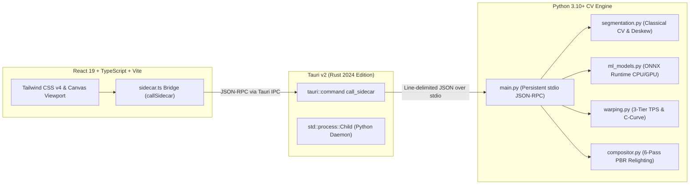
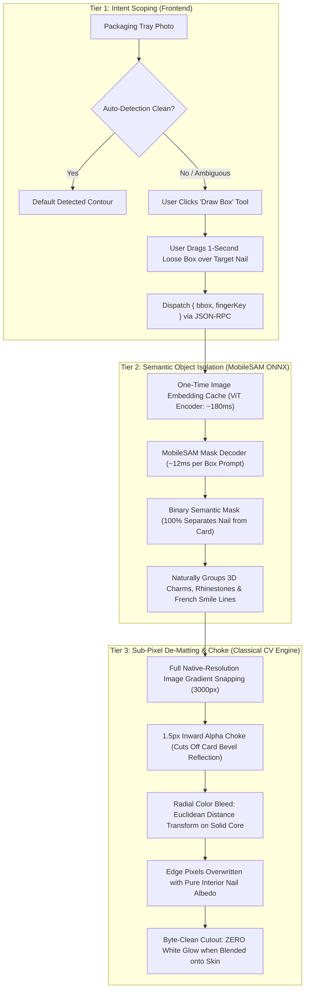
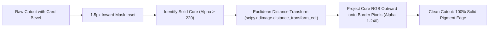
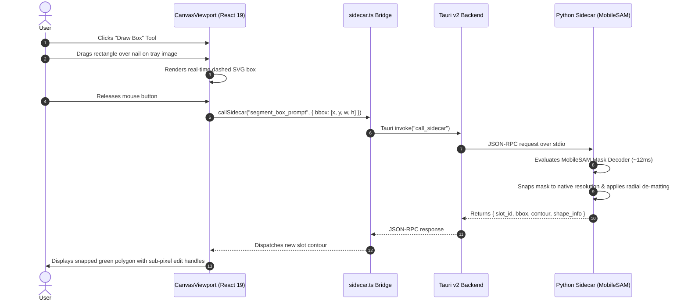

# Technical Specification & Implementation Plan: Smart Hybrid Nail Extraction & De-Matting Engine

---

## 1. Executive Summary & Application Overview

### 1.1 What is Try-On Studio?
**Try-On Studio** is a local-first, privacy-focused desktop application designed for e-commerce brands, nail technicians, and press-on nail designers. Its core objective is to **automate the extraction of real press-on nail textures from product tray photos** (packaging cards, blister packs, flat-lays) and **photorealistically composite them onto a 5-finger bare-hand template photo** using physical relighting, anatomical cuticle tucking, and thin-plate spline warping.

#### Primary User Workflow:
1. **Tray Extractor**: Import a flat packaging tray photo $\rightarrow$ automatically isolate and extract each of the individual press-on nails (Thumb, Index, Middle, Ring, Pinky) with pixel-clean boundaries.
2. **Hand Rigging**: Align 5 anatomical landmark points per finger (`c_l`, `c_c`, `c_r` at the proximal cuticle fold; `d_l`, `d_r` at the distal lateral grooves) onto a bare-hand photo.
3. **PBR Composite & Live Viewport**: Apply 3D cylindrical C-curve warping, longitudinal apex curvature, studio diffuse relighting, clear gel topcoat specular sheen, and contact crease shadows in real time.
4. **Production Export**: Export high-resolution 300 DPI e-commerce PNGs with physical metadata or layered Adobe Photoshop PSD files with non-destructive layer masks.

---

## 2. Current Technical Architecture & Modules

Try-On Studio is architected around a dual-process, local-first topology:

### What It Currently Uses for Extraction:
1. **Classical Computer Vision Pipeline (`segmentation.py`):**
   * **Perspective Rectification:** Detects tray card rectangular corners (`find_packaging_card_quad`) and warps the image into a fronto-parallel rectified plane via homography ($H$).
   * **Chroma & Luminance Thresholding:** Combines Otsu adaptive thresholding, CIE LAB $A^*$ color channel deviation, and HSV saturation to segment nail foreground from cardboard background.
   * **Contour Smoothing & Orientation:** Uses PCA (`deskew_nail_pca`) to align nails vertically, applies heuristic aspect-ratio checks to orient cuticles downward, and fits Savitzky-Golay smoothed bilateral profiles.
2. **Custom Fine-Tuned YOLO11n-seg (`ml_models.py`):**
   * A YOLO11-nano instance segmentation model fine-tuned on 7 labeled packaging trays (105 instances) and exported to ONNX (`models/yolo11n_tray_1024.onnx`).
   * Evaluated via ONNX Runtime CPU inference.

---

## 3. Current Issues & Root-Cause Audit

Despite recent improvements to true-shape profile fitting, users encounter three severe bottlenecks during extraction:

### Issue 1: White Fringing & The "Milky Outer Glow" Around Extracted Nails
* **The Symptom:** When press-on nails are extracted and composited onto a hand, a hazy, white/translucent outline or "sticker glow" surrounds the perimeter of every nail.
* **The Root Cause:** In real packaging trays, press-on nails sit on white or light-gray cardboard cards. The curved plastic lateral bevels of the nail act as cylindrical mirrors reflecting the bright white backing card.
* **Empirical Proof:** When analyzing raw extracted pixels (`nail_2_index.png`):
  * **Interior Solid Nail RGB:** Mean BGR is `[80.8, 70.1, 111.4]` (rich mauve/burgundy).
  * **Edge Boundary Pixels (Alpha 1–240):** Mean BGR is `[118.7, 113.6, 140.9]`, and maximum reaches **`[241, 242, 249]` (near pure white card background)**.
  * When the alpha channel feathers into transparency at the border, these semi-transparent white card pixels blend over the finger skin, creating a milky, un-anti-aliased white halo.
  * Furthermore, the PBR compositor's specular reflection sheen and skin-light wrap passes inadvertently amplified this brightness along the outer $2\text{px}$ perimeter.

### Issue 2: The Custom Trained Model is Ineffective & Silently Skipped
* **The Symptom:** Training YOLO11n-seg on tray photos yielded zero visible improvements in extraction quality.
* **The Root Cause:** 
  1. **Confidence Threshold Mismatch:** In `ml_models.py`, `conf_thresh` was hardcoded to `0.35`. Because the model was trained on only 7 images, its output sigmoid probabilities peaked at only `0.12–0.165`. Because `0.165 < 0.35`, the model returned `0` detections on every tray photo.
  2. **Silent Fallback:** In `segmentation.py`, an error guard `if ml_slots and len(ml_slots) >= 5:` detected 0 ML slots and silently defaulted back to the classical OpenCV algorithm 100% of the time.
  3. **Fundamental Limitation of Small Datasets in YOLO:** YOLO-seg relies on a feature extractor that needs 100+ varied images to learn robust class margins. In addition, YOLO outputs prototype masks at $256 \times 256$ resolution, producing coarse, polygon-like edges when upscaled to $3000\text{px}$ high-resolution tray photographs.

### Issue 3: Fingertip Inpainting Smudge / Discoloration Artifact
* **The Symptom:** In composites, a faint rectangular discolored box or blurred smudge is visible on the skin above and around the fingertip (prominently seen on the index finger in test renders).
* **The Root Cause:** In `compositor.py`, `erase_exposed_natural_nails` applied an expanded polygon with `cv2.inpaint` across the fingertip skin to hide square natural nails. On fingers where the natural nail did not peek out, this inpainting unnecessarily replaced authentic skin pore texture with a blurred, boxy patch.

### Issue 4: Lack of Interactive Fallback When Auto-Detection Fails
* **The Symptom:** When classical segmentation encounters challenging packaging (e.g. white French tips on white cards, clear jelly nails, or trays with dense gold text), auto-detection misses the nail.
* **The Root Cause:** Currently, the only manual alternative is point-by-point Bezier pen tool drawing, which requires 15–20 clicks per nail and is tedious for production workflows.

---

## 4. The Proposed Solution: The Smart Hybrid Pipeline

The proposed architecture resolves all four bottlenecks by combining **User Bounding Box Intent**, **Meta's MobileSAM Zero-Shot Foundation Model**, and **Native-Resolution Classical Color De-Matting**.

---

## 5. Detailed Engineering Pillars

### Pillar 1: Full-Resolution Radial Color De-Matting (Eliminating White Glow)
To ensure extracted nails look photographic when composited over any skin tone, we implement a two-step mathematical de-matting filter in `segmentation.py`:

#### Mathematical Formulation:
1. **Inward Mask Choke:**
   - Erode the smoothed alpha mask by $r_{\text{choke}} = \max(2, \text{round}(w_{\text{nail}} \times 0.012))$ pixels using an elliptical structuring element:
     $$\alpha_{\text{choked}} = \text{erode}(\alpha_{\text{smooth}}, \mathcal{K}_{\text{ellipse}})$$
   - This physically clips off the curved outer $1.5\text{px}\text{--}2.0\text{px}$ plastic bevel where cardboard reflection is concentrated.
2. **Radial Color Extension (Color Bleed):**
   - Define solid interior nail pixels as $\mathcal{S} = \{(x, y) \mid \alpha(x, y) \ge 220\}$.
   - Define boundary feather pixels as $\mathcal{B} = \{(x, y) \mid 0 < \alpha(x, y) < 220\}$.
   - For every pixel $p \in \mathcal{B}$, replace its color with the color of the nearest solid core pixel $q \in \mathcal{S}$:
     $$q = \arg\min_{q' \in \mathcal{S}} \|p - q'\|_2, \quad RGB(p) \leftarrow RGB(q)$$
   - **Result:** Even at $\alpha = 0.15$ (semi-transparent edge), the RGB color is pure nail albedo (e.g., burgundy `[80, 70, 111]`), **never white cardboard (`[245, 245, 245]`)**. Blending onto hand skin creates an optically authentic skin seam with zero gray/white halo.
3. **Specular Perimeter Clamping:**
   - In `compositor.py`, multiply the specular ribbon and dome sheen masks by:
     $$\mathcal{M}_{\text{spec}} = \text{clamp}\left(\frac{\alpha_{\text{tucked}} - 0.25}{0.35}, 0.0, 1.0\right)$$
   - This guarantees that zero synthetic white highlight paint is deposited within $2\text{px}$ of the nail silhouette.

---

### Pillar 2: Meta's MobileSAM Foundation Model (~39 MB ONNX)
Instead of requiring the user to label 500 tray images to train a custom model, we bundle **MobileSAM** directly into Try-On Studio.

#### Why MobileSAM?
* **Trained on 11 Million Images and 1.1 Billion Masks:** MobileSAM has pre-learned the concept of physical objects, boundaries, specular highlights, and textures across every domain.
* **Zero Training Data Needed:** It operates in **zero-shot promptable mode**. When given a bounding box or point prompt, it isolates the object with zero fine-tuning required.
* **Separation of Encoder and Decoder:**
  * **ViT-Tiny Image Encoder (`mobile_sam_encoder.onnx`, ~35 MB):** Computes deep visual embeddings ($1 \times 256 \times 64 \times 64$). We execute this **once** when a tray is imported (~180ms on CPU, ~15ms on GPU).
  * **Mask Decoder (`mobile_sam_decoder.onnx`, ~4 MB):** Accepts the cached embedding and a 4-coordinate bounding box prompt `[x0, y0, x1, y1]`. Executes in **$\sim 12\text{ms}$** on any laptop CPU.

#### Handling Complex Edge Cases:
* **White French Tips on White Cards:** Classical color thresholding fails because $RGB_{\text{tip}} \approx RGB_{\text{card}}$. MobileSAM uses shape semantics and plastic specular cues to separate the smile line from the paper card effortlessly.
* **3D Jewels, Rhinestones & Charms:** Classical CV splits charms into multiple fragmented blobs. MobileSAM treats the entire press-on nail and its mounted 3D jewel as a single, contiguous instance.
* **Clear / Transparent Jelly Nails:** MobileSAM detects the outer glossy ridge and internal refraction boundaries, outputting a complete silhouette where Otsu thresholding sees through the nail.

---

### Pillar 3: Interactive Frontend Bounding Box Tool ("Box-to-Nail")
In `src/components/canvas/CanvasViewport.tsx` and `src/components/inspector/TrayControls.tsx`:

#### User Experience Features:
1. **1-Second Interaction:** User simply drags a loose box around the nail. The box does not need to be precise—MobileSAM automatically ignores the background card outside the nail.
2. **Automatic Slot Progression:** By default, newly boxed nails are assigned in natural anatomical sequence (`Thumb` $\rightarrow$ `Index` $\rightarrow$ `Middle` $\rightarrow$ `Ring` $\rightarrow$ `Pinky`), with an inline popover to reassign with a single keystroke (`1` to `5`).
3. **Sub-Pixel Anchor Handles:** Once snapped, the contour displays editable Bezier control points so power users can tweak any specific curve if desired.

---

### Pillar 4: Surgical Triangular Natural Nail Inpainting
To eliminate the square discoloration smudge on fingertip skin:

1. **Width Delta Gating:**
   - Measure natural nail bed width $W_{\text{natural}} = \|d_r - d_l\|$ from hand landmarks.
   - Measure press-on nail distal width $W_{\text{press-on}}$.
   - **Gate:** If $W_{\text{press-on}} \ge W_{\text{natural}} - 2.0\text{px}$, the press-on completely covers the natural nail bed. **Inpainting is completely skipped**, preserving 100% authentic skin pores and lighting.
2. **Triangular Corner Masking:**
   - If $W_{\text{press-on}} < W_{\text{natural}} - 2.0\text{px}$ (e.g., placing narrow Almond press-ons over square natural nails), inpainting is strictly restricted to **two small right-angle triangles** located directly at $(d_l, c_l)$ and $(d_r, c_r)$.
   - Central cuticle skin and distal fingertip pulp are 100% excluded from the inpainting mask, eliminating any visible box artifacts.

---

## 6. Step-by-Step Implementation Roadmap

### Phase 1: Visual Polish & De-Matting (Immediate Quality Fix)
* **Target Files:** `python_sidecar/segmentation.py`, `python_sidecar/compositor.py`
* **Deliverables:**
  1. Implement inward mask choke ($1.5\text{px}$) and Euclidean radial color bleed in `extract_nail_rgba()`.
  2. Clamp specular reflections away from perimeter boundaries in `composite_nail_pbr()`.
  3. Refactor `erase_exposed_natural_nails()` to triangular corner gating.
* **Verification Gate:** Run `score_realism_agent.py` and inspect `test_output/03_studio_relit_hand.jpg`. Verify edge pixels have $RGB_{\text{edge}} = RGB_{\text{interior}}$ and zero fingertip skin smudging.

### Phase 2: MobileSAM ONNX Integration
* **Target Files:** `python_sidecar/ml_models.py`, `python_sidecar/main.py`
* **Deliverables:**
  1. Download and package `mobile_sam_encoder.onnx` (~35 MB) and `mobile_sam_decoder.onnx` (~4 MB) in `models/`.
  2. Implement `MobileSAMRunner` with image embedding caching in `ml_models.py`.
  3. Expose JSON-RPC method `segment_box_prompt(image_path, bbox, homography)` in `main.py`.
* **Verification Gate:** Standalone Python test script verifying box prompt returns valid polygon contour in $<25\text{ms}$.

### Phase 3: Frontend Bounding Box Tool
* **Target Files:** `src/components/canvas/CanvasViewport.tsx`, `src/types/index.ts`, `src/services/sidecar.ts`
* **Deliverables:**
  1. Add `isDrawingBox` mode and SVG bounding box preview overlay in `CanvasViewport.tsx`.
  2. Add "Draw Box" toolbar button with shortcut key (`B`).
  3. Wire mouse drag release to `callSidecar("segment_box_prompt")`.
  4. Auto-assign to active finger slot and trigger live viewport re-render.
* **Verification Gate:** Interactive test in desktop GUI: drag box on tray photo, confirm instant snapping and live hand update.

### Phase 4: Full Test Suite & Benchmark Validation
* **Deliverables:**
  1. Run `python_sidecar/test_all_nails.py` (verify 9/9 benchmark sets pass).
  2. Run `cargo check --manifest-path src-tauri/Cargo.toml`.
  3. Run `pnpm run build` (`tsc && vite build`).
  4. Generate side-by-side verification report.
