# Technical Specification: ML-Based Nail Segmentation & Hand Keypoint Rigging

**Target System:** Try-On Studio (`python_sidecar`)  
**Objective:** Replace brittle color-space heuristics and destructive super-ellipse contour fitting in `segmentation.py` and `template_generator.py` with lightweight, deterministic ONNX models (`YOLO11n-seg` and `YOLO11n-pose` + `MediaPipe Hands`) while preserving all existing API contracts, coordinate transformations, and downstream compositing logic.

---

## 1. Executive Summary & Root Cause Analysis

### 1.1 Current Failure Modes in Classical Pipeline
1. **Tray Nail Extraction (`python_sidecar/segmentation.py`):**
   - **Color/Shadow Ambiguity:** Multi-cue thresholding (`cue_chroma`, `cue_dark`, `cue_white_tip`) fails when sheer/jelly bases or white French tips match the luminance/chrominance of the white backing card, or when directional flash creates dark cast shadows.
   - **Convex Hull Bridging:** Wrapping noisy slot masks in `cv2.convexHull` bridges across concave tapers and shadow artifacts, destroying the true sidewall geometry.
   - **Destructive Super-Ellipse Fitting (`build_symmetric_smooth_nail_mask`):** Forcing a 2-piece Lamé curve with strong priors around $(p=1.82, q=2.18)$ and applying a mandatory top $14\%$ elliptical cap (`ellip_tip`) mathematically rounds off **Square**, **Squoval**, and **Coffin** corners into **Oval/Almond** shapes.
2. **Hand & Nail-Bed Rigging (`python_sidecar/template_generator.py`):**
   - **Skin-Tone Sensitivity:** Hardcoded `YCrCb` and `HSV` skin masks fail under varied lighting, shadows, or across very dark/pale skin tones.
   - **Heuristic Anchor Guessing:** Estimating the 5 nail-bed rigging landmarks ($c_l, c_c, c_r, d_l, d_r$) purely as fixed multiples of finger width ($2.2 \times W_{\text{half}}$) ignores individual nail-bed anatomy, camera perspective on angled thumbs, and short vs. long nail beds.

### 1.2 Target Hybrid ML Architecture
We replace only the brittle perception stages with two ultra-lightweight ONNX models (~6–10 MB each, $< 30\text{ ms}$ CPU inference via `onnxruntime`) while retaining classical projective geometry:

```mermaid
flowchart TD
    subgraph Pipeline A: Packaging Tray Nail Extraction
        A1["Raw Tray Image"] --> A2["Step 1: Backing Card Homography (rectify_backing_card - KEEP)"]
        A2 --> A3["NEW: YOLO11n-seg ONNX Inference (imgsz=1024, retina_masks=True)"]
        A3 --> A4["NEW: Shape-Preserving Periodic B-Spline Smoothing (Replaces Super-Ellipse)"]
        A4 --> A5["Step 4-6: PCA Deskew, Inversion Check & Shape Classifier (KEEP)"]
        A5 --> A6["Step 7: extract_nail_rgba(exact_mask=True) + Fringe Cleanup (KEEP)"]
    end

    subgraph Pipeline B: Hand & 5-Point Nail Rigging
        B1["Raw Hand Image"] --> B2["NEW Stage 1: MediaPipe Hands / YOLO11n-pose (Fingertip ROI Crops)"]
        B2 --> B3["NEW Stage 2: YOLO11n-pose Nail-Bed Keypoint Model (5 Anchors + Seg Mask)"]
        B3 --> B4["Global Coordinate Mapping: [c_l, c_c, c_r, d_l, d_r] per Finger"]
    end
```



---

## 2. Pipeline A: Packaging Tray Nail Instance Segmentation (`YOLO11n-seg`)

### 2.1 Dataset Preparation & Annotation Rules
- **Minimum Dataset Size:** 60–100 tray photographs (yields $900–2,000$ individual nail instances).
- **Diversity Requirements:**
  - Shapes: Square, Squoval, Coffin/Ballerina, Almond, Oval, Stiletto.
  - Finishes: White French tips on white cards, sheer/jelly nude, jet-black, chrome/cat-eye, glitter, 3D charms.
  - Lighting: Direct phone flash (hard cast shadows), warm indoor lighting, angled perspective trays.
- **Annotation Tool:** Roboflow (Smart Polygon / SAM) or AnyLabeling (Segment Anything model assisted).
- **Classes:**
  - `0: nail` (Required — exact outer plastic perimeter of each press-on nail).
  - `1: backing_card` (Optional — the 4-corner presentation card to assist or replace `rectify_backing_card`).
- **Strict Labeling Guidelines for `nail`:**
  1. **Exclude Plastic Number Tabs:** Do not include the small clear/colored manufacturing tab protruding from the free-edge tip.
  2. **Exclude Cast Shadows:** Trace strictly along the physical 3D plastic rim of the nail, excluding dark cast shadows on the backing card.
  3. **Preserve Sharp Corners:** On Square and Coffin nails, place explicit polygon vertices at the two distal tip corners so the ground-truth polygon does not round them off.

### 2.2 Training Configuration (Ultralytics YOLO11)
The Coding Agent should create `scripts/train_tray_seg.py`:

```python
from ultralytics import YOLO

def train_tray_segmentation():
    # Load pretrained YOLO11 nano segmentation model
    model = YOLO("yolo11n-seg.pt")

    model.train(
        data="datasets/tray_nails/data.yaml",
        epochs=120,
        imgsz=1024,          # CRITICAL: High resolution required for thin tips & sharp corners
        batch=8,
        retina_masks=True,   # Full-resolution mask supervision
        overlap_mask=False,  # Nails in trays are disjoint; prevents mask bleeding
        degrees=15.0,        # Rotational augmentation
        perspective=0.0005,  # Perspective tilt augmentation
        flipud=0.5,          # Handles inverted vs upright nails
        fliplr=0.5,
        mosaic=0.5,          # Moderate mosaic to keep high pixel density per nail
        hsv_h=0.02,
        hsv_s=0.4,
        hsv_v=0.4,
        project="runs/tray_seg",
        name="yolo11n_tray_1024",
    )

    # Export to ONNX for CPU/GPU sidecar deployment
    best = YOLO("runs/tray_seg/yolo11n_tray_1024/weights/best.pt")
    best.export(
        format="onnx",
        imgsz=1024,
        simplify=True,
        opset=17,
        dynamic=False,
    )

if __name__ == "__main__":
    train_tray_segmentation()
```

### 2.3 Post-Processing & Shape-Preserving Contour Smoothing
Once `yolo11n_tray_1024.onnx` predicts the binary mask or polygon for each nail slot inside `rect_img`:
1. **Do NOT call `cv2.convexHull`:** Use the raw external contour from the high-resolution segmentation mask.
2. **Replace `build_symmetric_smooth_nail_mask` with Periodic B-Spline / Adaptive Savitzky-Golay:**
   - Resample the detected nail contour to 200 equidistant arc-length points.
   - Smooth pixel staircase jitter using `scipy.interpolate.splprep(pts, s=smooth_factor, per=True)` where `s` is small ($0.5–1.5\text{ px}^2$) so **Square** and **Coffin** corners remain sharp while jagged raster steps disappear.
   - If bilateral symmetry is desired, only enforce elliptical U-cup rounding on the **bottom $15\%$ (cuticle base)** and keep the **top $85\%$ (sidewalls and free-edge tip)** faithful to the smoothed scanline widths.
3. **Row/Column Slot Ordering Contract:**
   - Sort detected nail centroids into horizontal rows by clustering $c_y$ (threshold $\Delta y < 0.12 \times H_{\text{card}}$), then sort left-to-right by $c_x$ within each row so `slot_id` ($1 \dots N$) matches the exact deterministic order of the legacy algorithm.
4. **Integration with `extract_nail_rgba`:**
   - Call `extract_nail_rgba(..., exact_mask=True)` using the smoothed polygon contour.
   - Retain the **Step Extra A (Telea fringe ring inpainting)** on the outer $2\text{px}$ boundary ring so zero white card background leaks into anti-aliased edges.

---

## 3. Pipeline B: Hand & 5-Point Nail-Bed Keypoint Detection (`YOLO11n-pose`)

### 3.1 Anatomical Landmark Contract
Downstream warping (`warping.py` and `template_generator.py`) requires 5 exact anatomical keypoints per finger nail bed:
1. **`c_l` (Index 0):** Left cuticle corner (proximal-lateral fold intersection).
2. **`c_c` (Index 1):** Cuticle center apex (proximal eponychium bottom center).
3. **`c_r` (Index 2):** Right cuticle corner (proximal-lateral fold intersection).
4. **`d_l` (Index 3):** Left distal sidewall point (where the lateral nail fold meets the free edge / hyponychium).
5. **`d_r` (Index 4):** Right distal sidewall point (where the lateral nail fold meets the free edge / hyponychium).

*(Optional 6th keypoint `tip_c` at the center of the free edge can be included to measure natural free-edge length).*

### 3.2 Two-Stage vs. Single-Stage Architecture
We recommend a **Single-Stage High-Res `YOLO11n-pose` (`imgsz=1024`)** model (or **2-Stage MediaPipe Hands $\rightarrow$ Fingertip Crop `YOLO11n-pose` (`imgsz=256`)** for maximum sub-pixel accuracy):

- **Option 1 (Recommended for highest accuracy): MediaPipe Hand Landmarker + Cropped Nail-Bed Pose Model**
  1. Run pre-trained **MediaPipe Hands** on the full hand photo to get the 21 standard hand skeleton joints (`DIP` and `TIP` for Thumb, Index, Middle, Ring, Pinky) and automatic Left/Right handedness classification.
  2. For each of the 5 fingers, compute the finger axis vector $\vec{v} = P_{\text{TIP}} - P_{\text{DIP}}$, rotate the local fingertip patch upright, and crop a $256 \times 256$ window centered on the nail bed.
  3. Run a fine-tuned **`YOLO11n-pose` (`imgsz=256`)** on each upright fingertip crop to predict the 5 exact nail-bed keypoints $[c_l, c_c, c_r, d_l, d_r]$.
  4. Project the 5 keypoints back to full-image coordinates via the inverse affine crop matrix.
  - **Why this wins:** Because every fingertip crop is already upright and normalized in scale, the `YOLO11n-pose` model achieves sub-pixel accuracy even when trained on just **50–80 hand photos** ($250–400$ fingertip crops), and handles sideways thumbs effortlessly.

- **Option 2 (Simpler Single-Model): Full-Hand `YOLO11n-pose` (`imgsz=1024`)**
  1. Run a single `YOLO11n-pose` model on the full hand image that detects 5 `nail_bed` bounding boxes per hand and outputs the 5 keypoints $[c_l, c_c, c_r, d_l, d_r]$ for each detected nail bed directly.

### 3.3 Dataset & Keypoint Configuration (`hand_nails_pose.yaml`)
```yaml
path: ../datasets/hand_nail_keypoints
train: images/train
val: images/val

# Keypoint definition: 5 keypoints per nail bed, each with (x, y, visibility)
kpt_shape: [5, 3]
# Horizontal flip symmetry swaps left and right anchors:
# c_l (0) <-> c_r (2), c_c (1) stays (1), d_l (3) <-> d_r (4)
flip_idx: [2, 1, 0, 4, 3]

names:
  0: nail_bed
```

### 3.4 Training Script for Nail-Bed Keypoints (`scripts/train_hand_pose.py`)
```python
from ultralytics import YOLO

def train_nail_bed_pose():
    model = YOLO("yolo11n-pose.pt")

    model.train(
        data="datasets/hand_nail_keypoints/hand_nails_pose.yaml",
        epochs=150,
        imgsz=256,           # Use 256 if training on upright MediaPipe fingertip crops, or 1024 for full hand
        batch=16,
        pose=12.0,           # High weight on keypoint localization loss (OKS)
        degrees=25.0,
        fliplr=0.5,          # Uses flip_idx: [2, 1, 0, 4, 3] automatically
        hsv_h=0.03,          # Skin-tone augmentation
        hsv_s=0.5,
        hsv_v=0.5,
        project="runs/hand_pose",
        name="yolo11n_nailbed_pose",
    )

    best = YOLO("runs/hand_pose/yolo11n_nailbed_pose/weights/best.pt")
    best.export(format="onnx", imgsz=256, simplify=True, opset=17)

if __name__ == "__main__":
    train_nail_bed_pose()
```

---

## 4. Coding Agent Implementation Checklist & Drop-In Architecture

The Coding Agent should execute the following refactoring tasks in `python_sidecar`:

### Task 1: Model Loader & ONNX Runtime Wrapper (`python_sidecar/ml_models.py`)
- Create a singleton model manager that loads:
  - `models/yolo11n_tray_1024.onnx` (Tray Nail Segmentation)
  - `models/yolo11n_nailbed_pose.onnx` (Hand Nail-Bed 5-Keypoint Pose)
- Use `onnxruntime.InferenceSession` (with `CPUExecutionProvider` and optional `CUDAExecutionProvider` / `CoreMLExecutionProvider`) so the sidecar does not require PyTorch at runtime in production builds.
- Include a graceful fallback flag (`USE_ML_DETECTION = True` if `.onnx` weights exist, otherwise fallback to improved classical pipeline).

### Task 2: Refactor `segmentation.py` (Preserve Return Signatures)
1. **Fix `build_symmetric_smooth_nail_mask` immediately (Classical Fallback & Optional Post-Processor):**
   - Remove the Lamé super-ellipse grid search (`p_cand`, `q_cand`) and remove the top $14\%$ elliptical cap (`ellip_tip`).
   - Replace with a periodic cubic B-spline (`scipy.interpolate.splprep`) on the contour vertices, or apply Savitzky-Golay smoothing on scanline half-widths while only applying elliptical rounding to the bottom $15\%$ cuticle base (`ellip_cut`).
   - Remove `cv2.convexHull` calls on final nail masks in `segment_packaging_tray`.
2. **Integrate `yolo11n_tray_1024.onnx` inside `segment_packaging_tray(image, max_slots=15)`:**
   - Step 1: Run `rect_img, H, card_quad = rectify_backing_card(image)`.
   - Step 2: Run ONNX segmentation on `rect_img` to obtain high-res instance masks.
   - Step 3: Smooth each mask contour via periodic B-Spline, compute `deskew_nail_pca` and `classify_nail_shape`, and project contour coordinates back to original image space via $H^{-1}$.
   - Return the exact existing dictionary schema (`slot_id`, `bbox`, `contour`, `area`, `aspect_ratio`, `pca_angle`, `shape_info`, `homography`, `card_quad`).
3. **Update `extract_nail_rgba`:**
   - Default `exact_mask=True` when contours originate from the ML segmentation model, while still running the **Step Extra A Telea fringe cleanup** (`inpaintRadius=3.0`) along the outer $2\text{px}$ boundary ring so no white card halo appears.

### Task 3: Refactor `template_generator.py` (Hand Rigging)
1. Replace `YCrCb`/`HSV` skin thresholding and distance-transform peak finding with:
   - **Stage 1:** MediaPipe Hands (or full-hand YOLO detection) to identify the 5 fingers (`thumb`, `index`, `middle`, `ring`, `pinky`), handedness (`left` vs `right`), and distal finger axis vectors.
   - **Stage 2:** Crop each fingertip aligned to its distal phalanx axis, run `yolo11n_nailbed_pose.onnx`, and transform the 5 predicted keypoints $[c_l, c_c, c_r, d_l, d_r]$ back into original image coordinates.
2. Preserve the exact output JSON/dict structure expected by `warping.py` and `compositor.py`.

---

## 5. Acceptance Criteria & Verification Tests
1. **Shape Fidelity Test:**
   - Run `segment_packaging_tray` and `extract_nail_rgba` on Coffin, Square, Stiletto, and White French Tip tray images.
   - Verify that Square and Coffin nails retain flat distal tips (`flattening_ratio > 0.62`) and are not rounded into Ovals.
   - Verify zero cast-shadow inclusion on dark pigment nails and zero missing tips on white French tip nails.
2. **Hand Keypoint Accuracy Test:**
   - Run hand template detection across light, medium, and dark skin tones under warm and cool lighting.
   - Verify all 5 fingers (including the angled thumb) receive accurate $[c_l, c_c, c_r, d_l, d_r]$ coordinates within $\le 3\text{px}$ of manual ground truth.
3. **Performance Budget:**
   - End-to-end tray segmentation $\le 150\text{ ms}$ on CPU.
   - End-to-end 5-finger hand rigging $\le 100\text{ ms}$ on CPU.